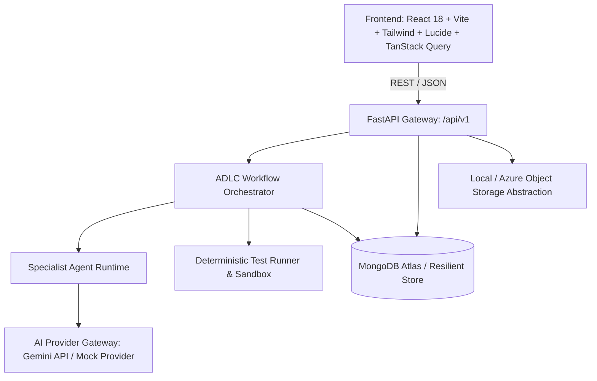

# GENQUANTAA ADLC — Architecture and Implementation Plan

## 1. Executive Summary & Objective
**GENQUANTAA ADLC (AI Development Lifecycle Platform)** is an enterprise-grade AI Engineering Orchestration Platform designed to systematically plan, design, develop, test, evaluate, govern, deploy, monitor, and improve AI applications.

The pilot application is:
> **End-to-End CSV Copilot for GxP ADLC**
> Demonstrating: Project Creation → Document Upload → Text Extraction → AI-Assisted Requirements Drafting (Agent 1) → Human Review & Approval → Planning & Task Generation (Agent 2) → Test Case Generation → Actual Test Execution (Deterministic Runner / Agent 7) → Risk & Compliance Drafting (Agent 8) → Traceability & Evidence Persistence → Lifecycle Dashboards and Summary Reports.
> *(Prototype notice: Prototype demonstration only; not claimed as validated GxP or compliant by default without independent qualification).*

---

## 2. System Architecture & Component Design

### Key Architectural Layers:
1. **Frontend Presentation Layer**:
   - Modern enterprise SaaS design with crisp light theme (white surfaces, slate borders, purple/blue/teal accents, Inter font).
   - Sidebar navigation: Overview, Projects, ADLC Pipeline, Requirements, Tasks, AI Agents, Data and Datasets, Testing and Evaluations, Risks and Compliance, Traceability, Evidence and Reports, Approvals, Integrations, Settings.
   - Real-time workflow state observation, run history, and interactive approval gates.

2. **FastAPI Application & API Gateway**:
   - Versioned API (`/api/v1`), OpenAPI documentation (`/docs`).
   - Clean modular layer: routers, services, repositories, schemas, models.
   - Robust error handling, non-blocking asynchronous job tracking (`workflowRunId`, `stepRunId`, `jobId`).

3. **ADLC Workflow Orchestrator**:
   - Authoritative state machine governing the 8 lifecycle stages.
   - Prerequisite checks, human-in-the-loop gates (e.g. requirement approval required before task generation).
   - Idempotency, retry limits, step run telemetry, and error captures.

4. **Specialist Agent Registry & Runtime**:
   - 11 Agent definitions in registry (4 active MVP: Intake & Requirements, Planning & Tasks, QA & Test, AI Risk & Compliance; 7 planned).
   - Strict Pydantic input/output validation, scoped prompts, token and cost accounting.

5. **Deterministic Test Runner**:
   - Real execution of tests on sample CSV validation / ingestion modules.
   - Execution timing, stdout/stderr capture, pass/fail assertions linked to requirement & test-case IDs.

6. **Storage & Data Layer**:
   - MongoDB persistence with indexes for organizations, projects, requirements, tasks, test runs, evidence records, traceability links, approvals, audit events.
   - Resilient database connection layer: connects to live MongoDB Atlas, with graceful auto-fallback to an in-memory/file-backed mock collection engine during offline local dev.
   - Abstract file storage (Local disk with checksums, ready for Azure Blob Storage).
